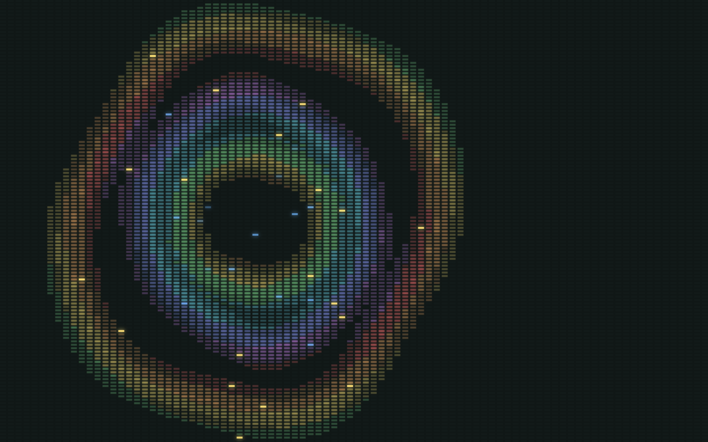

<div align="center">

# virizuals

**A little light. A little noise. Nothing to do but play.**

A fullscreen, pixel-art ripple playground made of tiny LCD segments.

[](https://github.com/jameswilliamknight/virizuals/actions/workflows/pages.yml)
[](LICENSE)
[](https://www.typescriptlang.org/)
[](https://nuxt.com/)

**[Open the playground ↗](https://jameswilliamknight.github.io/virizuals/)** · [Run locally](#run-locally) · [How it works](#under-the-glass)



</div>

No account. No controls to learn. No dashboard pretending to be an instrument.
Just a dark field of segments that catches your movement and sends colour outward.

## Play

| Gesture | What happens |
| :-- | :-- |
| **Move** | A soft, stepped glow follows the pointer. It wakes gently and fades when you stop. |
| **Click / tap** | A rainbow wave expands from the point of contact. |
| **Hold** | New waves arrive at irregular 100–250ms intervals. Older waves finish naturally. |
| **Tab, then Enter / Space** | Send a ripple from the centre without a mouse. |

Each wave has a slightly uneven edge, a seven-colour palette and a scattering of
yellow sparkles that cool to blue. Motion advances in **12fps poses**, with four
illumination levels: deliberately a little crunchy, not another smooth gradient.

The surface respects **reduced motion**: ripples and sparkles are disabled, and
hover illumination changes without animated fades. Background tabs stop animating.

## Run locally

Requires **Node.js 24** and **pnpm 12.4.1**. No API keys, database, private packages
or sibling repositories.

```sh
git clone https://github.com/jameswilliamknight/virizuals.git
cd virizuals
pnpm install
pnpm dev
```

Open **http://127.0.0.1:42119**.

<details>
<summary><strong>An anywhere-in-your-terminal command</strong></summary>

On macOS/Linux, run `./install.sh` once. It installs a symlink in `~/.local/bin`
without replacing an unrelated command. Ensure that directory is on your `PATH`.

```sh
virizuals                       # launch and open the browser
virizuals --headless            # launch without opening a tab
virizuals --takeover            # explicitly replace this project's dev server
virizuals --headless --takeover
```

Use **Ctrl+C** to stop. The launcher never silently switches ports; takeover is
opt-in. `virizuals --help` shows the options.

</details>

## Under the glass

**Vue + Nuxt + TypeScript + Canvas 2D + Tailwind CSS.** No graphics engine.

- **Whole segments, not scaled bars.** A responsive grid retains its four-pixel cell height.
- **Stepped time and light.** Ripple poses update at 12fps while hover fades remain gentle.
- **Balanced irregularity.** Stable angular harmonics vary each wave's reach without shifting its centre.
- **Sparkles follow the wave.** Each wave selects 20–50 visible cells, timed to its arrival.
- **No premature expiry.** Waves live for their duration, not until another click replaces them.
- **Work only when needed.** Frame scheduling stops when idle. Wave lighting is cached between animation ticks.

```text
app/
├── app.vue                         fullscreen composition
├── components/ui/UiRippleSurface.vue
├── composables/useRippleSurface.ts input, lifecycle and scheduling
└── utils/
    ├── ripple-surface.ts           geometry, light and sparkle timing
    └── ripple-surface-renderer.ts  canvas drawing and pose cache
```

Born as a tiny decorative effect in a local TV remote prototype, then stripped
back until the effect was the whole thing. This is a visual toy, **not an audio
visualiser**: it does not listen to your microphone or analyse media.

## Develop

```sh
pnpm test          # geometry, timing, sparkle and launcher regression tests
pnpm typecheck     # Vue / TypeScript checks
pnpm build         # production build
pnpm generate      # static output in .output/public
```

The [Pages workflow](.github/workflows/pages.yml) checks pull requests and deploys
`main` to GitHub Pages. Deployment builds use `NUXT_APP_BASE_URL=/virizuals/`;
local development stays at `/`. GitHub Pages must use **GitHub Actions** as its
build source.

There is no app backend, analytics or account storage. GitHub Pages handles
hosting; its usual infrastructure logging still applies.

## Make it yours

Small, thoughtful contributions are welcome—especially performance improvements,
accessibility fixes and visual refinements that preserve the quiet, segment-based
feel. See [CONTRIBUTING.md](CONTRIBUTING.md) before opening a pull request.

[Report a bug](https://github.com/jameswilliamknight/virizuals/issues/new?template=bug.yml)
· [Suggest an idea](https://github.com/jameswilliamknight/virizuals/issues/new?template=idea.yml)
· [Security policy](SECURITY.md)
· [Code of conduct](CODE_OF_CONDUCT.md)

## Licence

[MIT](LICENSE) © 2026 James William Knight.
